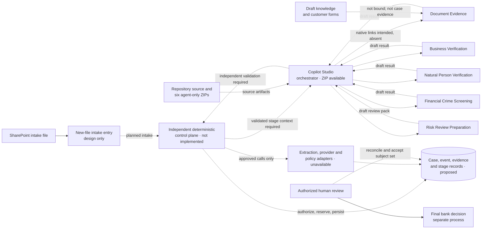
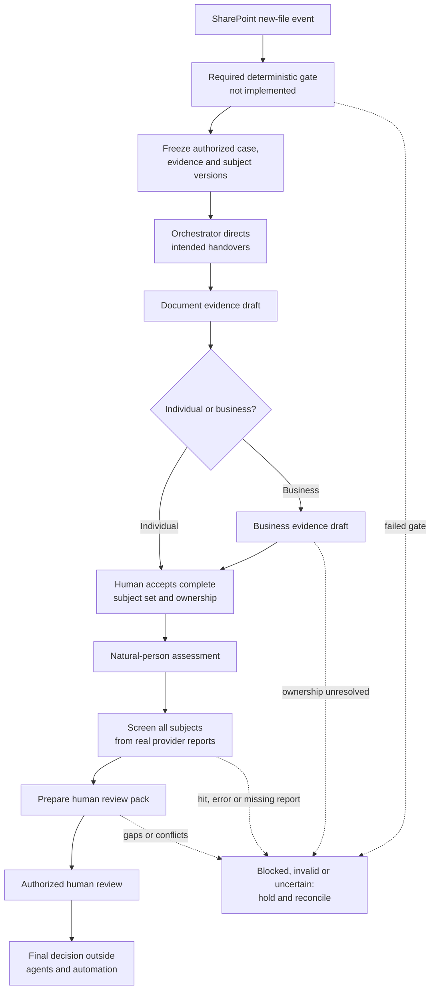

<div align="center">

# 🏦 Customer Onboarding Agent

**A source-first, multi-agent onboarding workflow design for an EU/EEA bank**

[](#-delivery-status)
[](#-architecture)
[](#-scope-and-intended-use)
[](#versioned-contracts)

*Controlled intake, traceable evidence preparation, and human-led review — not automated onboarding decisions.*

</div>

> [!IMPORTANT]
> **Six agent-only solution ZIPs are available, but no tenant import has been verified.** Native connected-agent links, a deterministic control plane and tenant bindings are not included. Model-directed handovers are not enforced gates. See the [handover guide](orchestrator/v2/connected-agent-handover.md). Do not use real customer data with this scaffold.

## ✨ At a glance

This project describes a staged onboarding workflow for **individuals and businesses** in an EU/EEA banking context:

- **V1 intake design:** a SharePoint new-file event would be normalized and durably claimed before sending metadata-only JSON to a Copilot Studio intake agent. The flow and agent are not provisioned; `PendingIntegration` would not create a customer or case.
- **V2 source-first expansion:** the Copilot Studio orchestrator is designed to call five connected specialists using explicit contracts. Independent deterministic controls must authorize, reserve, validate and persist every stage; they are not implemented.
- **Human control:** ownership, identity conflicts, possible screening hits, risk and final onboarding decisions remain subject to authorized human review. The workflow never equates a draft with a verification or approval.
- **Local utilities:** PowerShell contract checks and a dependency-free Node.js generator for nine editable Word template drafts.

## 🧭 Contents

- [Delivery status](#-delivery-status)
- [Scope and intended use](#-scope-and-intended-use)
- [Architecture](#-architecture)
- [Workflow walkthrough](#-workflow-walkthrough)
- [Specialist agents](#-specialist-agents)
- [Data, contracts, and controls](#-data-contracts-and-controls)
- [Repository map](#-repository-map)
- [Run local checks and generate templates](#-run-local-checks-and-generate-templates)
- [Tenant setup and controlled deployment](#-tenant-setup-and-controlled-deployment)
- [Security, privacy, and recovery](#-security-privacy-and-recovery)
- [Known limitations](#-known-limitations)

## 🚦 Delivery status

| Area | Current state | What this means |
| --- | --- | --- |
| Agent packaging | Six [PAC-generated solution ZIPs](deployment/packages/), build script and offline authoring inventory | Archive structure, prompts and capability settings checked locally; no tenant import. |
| V1 SharePoint intake | Manual setup guide, instructions, JSON schemas and synthetic fixtures | No flow or agent has been provisioned, published or tenant-tested. |
| V2 cases and specialists | Agent ZIPs, manual link setup, instructions, routes and examples | Links, deterministic control plane, case list, provider adapters and permission model are not deployed or verified. |
| Knowledge pack | `0.1.0-draft` reference material | Not approved legal advice, bank policy, a rule engine or production knowledge configuration. |
| Customer templates | CO-00–CO-08 editable Word drafts | Not approved forms, protected form controls, signed records or a customer portal. |
| Local validation | PowerShell contract checks; Node.js template generator | These run locally; they do not prove cloud behavior, permissions, model behavior or provider execution. |

**Only synthetic examples are included.** Microsoft Power Platform resources, SharePoint lists, connections, credentials, provider integrations, screening results and customer records are not included or claimed to exist.

## 🎯 Scope and intended use

The design covers document intake and controlled preparation of customer due-diligence evidence for individual and business onboarding. It is intended as a **starting point for a bank's engineering, operations, Compliance, Legal, Data Protection Officer (DPO), MLRO and Tax teams** to review and adapt.

It is not a universal KYC checklist or a statement of the rules applicable in any particular country. The bank must define and approve its policies, national and EEA overlays, providers, lawful basis, accepted evidence, retention, access model, and customer communications before use.

## 🏗️ Architecture

The **current design target** is a Copilot Studio orchestrator intended to call five specialist agents through native connected-agent links. The diagram distinguishes repository artifacts from components that would need to be authored and verified in a tenant. It is not a deployment diagram.



Dashed connections are **planned, missing, or model-directed—not verified runtime links**. The six agent-only ZIPs are present in the repository, but no tenant import has been verified. In particular, native connected-agent links, a control plane that can gate each call and result, SharePoint case/evidence/stage structures, and approved provider or policy adapters are not implemented or verified. Keep V2 disabled; if deterministic per-stage interposition cannot be enforced, redesign the dispatcher rather than treating agent instructions as a gate.

### Component responsibilities and state

| Component | State and boundary |
| --- | --- |
| SharePoint intake and V1 flow | Metadata-only new-file intake is a source design; no flow or agent is provisioned. It does not dispatch specialists. |
| Orchestrator and five specialists | Six agent-only ZIPs are available. The orchestrator is intended to use native connected-agent handovers; links and tenant behavior are unverified. Calls and ordering are model-directed. |
| Independent deterministic control plane | Required, not implemented: authorize actor/case/evidence, reserve event and case, validate and persist every request/result before another stage, and hold/reconcile uncertain outcomes. |
| Case, event, evidence and stage records | Proposed restricted SharePoint structures. Exact-ETag writes, unique keys, versioned snapshots and permission enforcement require tenant implementation and testing. |
| Extraction/provider/policy adapters | Not configured or implemented. Real evidence and reports require separately approved adapters; configuration examples do not prove execution. |
| Knowledge, forms and human review | Knowledge and forms are drafts, not runtime evidence or approved policy. Humans reconcile ownership and exceptions and retain all verification and final decision authority. |

### Intended route and control gates

This flow is a **design walkthrough**, not an executable or tenant-verified process. Independent controls must authorize and reserve before each stage and validate/persist its result before the next stage; this per-call interposition is not implemented.



For individuals, the reviewed subject set precedes identity assessment. For businesses, human reconciliation of ownership and acceptance of the complete related-person set precede those checks. Screening covers the business and every in-scope person; a risk agent prepares a pack but does not make the decision. An uncertain dispatch is reconciled, never automatically retried.

## 🔄 Workflow walkthrough

### V1 — metadata-only intake baseline

**Source design only:** no V1 flow or agent has been provisioned, published or tenant-tested. In the intended V1 path:

1. A new file in the configured SharePoint library would trigger **When a file is created (properties only)**. This is library-scoped; existing files and edits/overwrites are not backfilled as new-file events.
2. The flow would reject folders and invalid or missing metadata, then construct a normalized event. File name and identifier are metadata, not customer or case identity. No `Get file content` action belongs in this slice.
3. A restricted SharePoint ledger would enforce uniqueness of `EventKey` to arbitrate duplicate/concurrent delivery. Only the run that confirms its claim could continue.
4. The flow would call Copilot Studio **Execute Agent and wait** with one serialized JSON event and an empty conversation ID. V1 metadata-only events do not invoke specialists.
5. The flow would validate the response envelope and exact schema/correlation, then write `PendingIntegration`. Connector ambiguity, invalid responses and persistence errors must remain visible as `Failed` or `NeedsReconciliation`; they are not success.

If implemented and successfully recorded, `PendingIntegration` would mean only that the intake assessment was durably recorded. It would **not** create a customer or case, run identity/KYC/AML checks, approve a customer or complete onboarding.

### V2 — case-linked specialist design

V2 is a compatible, manual extension; it does not mutate V1 schemas or re-interpret a V1 pending result as successful downstream work. It is not deployed or verified. Never enable both V1 and V2 file-creation trigger paths for the same intake.

1. The control-plane design requires validating case metadata against the bank-managed case list, configured tenant/site/library, case intake folder, verified permissions and authenticated upload context. Missing or invalid case metadata is held for review; a model or filename never supplies identity or case linkage.
2. After authorization, it would freeze the case, policy, subject-set and file-version context. A case-level exact-ETag reservation is required to prevent overlapping work on the same case while allowing separate cases to proceed.
3. Role-specific requests would be stored in versioned snapshots and unique stage-journal rows. Providers may be called only by separately approved/configured adapters; model agents receive validated task context, never arbitrary endpoints or provider credentials.
4. The orchestrator instructions specify native connected-agent handovers in route order. The independent control plane must validate and reserve every call and result before the next stage. This interposition is not implemented; model-directed calls are not guaranteed to follow the order.
5. The control plane would aggregate all upstream issues and holds without allowing a risk summary to erase them, then conditionally release only reservations owned by that run. Final approved/rejected/closed transitions remain outside this workflow.
6. Eligible pending work could be resumed only by an authorized operator through the separate selected-item flow after review. Resume must preserve the same event key and history; uncertain dispatches require reconciliation, not blind retry.

**Routes:**

- **Individual:** document evidence → reviewed in-scope person set → natural-person assessment → financial-crime screening of every in-scope subject → risk-review preparation.
- **Business:** document evidence → business registry/ownership/authority evidence → **human-reconciled ownership and subject set** → natural-person assessment for related people → screening of the business and all relevant people → risk-review preparation.

An incomplete ownership graph blocks the related-person and screening stages until a human accepts the subject set. Possible screening hits cannot be cleared by an agent. When a provider or policy binding is absent, the stage is blocked and no fictitious result is created.

## 🤖 Specialist agents

Each V2 specialist has a distinct instruction file and role-discriminated request/result contract. Shared instructions establish data boundaries and require exactly one JSON response. A configured ID or draft response never proves that a provider ran.

| Role | Preparation responsibility | Required binding in a future tenant |
| --- | --- | --- |
| `document-evidence` | Classify documents and propose source-located evidence claims; does not verify identity. | `documentExtractor` |
| `natural-person` | Prepare identity evidence assessments for customers, representatives and beneficial owners. | `identityProvider` |
| `business` | Prepare business, ownership and representation evidence for human reconciliation. | `businessProvider` |
| `financial-crime` | Summarize approved-source reports for all in-scope people and businesses; never clear hits. | `screeningProvider` |
| `risk-review` | Prepare a traceable review pack from approved, versioned rule outputs; no model decision. | `policyRules` |

The orchestrator is intended to pass serialized role-specific JSON to native connected agents. Conversation history must be disabled and dispatches must not automatically retry. The required independent control plane—not the model—must enforce authorization, stage gates, idempotency, result validation, persistence and recovery; it is not implemented.

## 🧾 Data, contracts, and controls

### Versioned contracts

- **V1:** `orchestrator/contracts/intake-event.schema.json` and `orchestrator/contracts/orchestration-result.schema.json` define a metadata-only event and explicit pending-integration result. Synthetic fixtures live in `orchestrator/examples/`.
- **V2:** `specialists/contracts/specialist-request.schema.json` and `specialists/contracts/specialist-result.schema.json` define role-specific tasks, version/case/event correlation, allowed references and non-decision outcomes.
- **V2 sidecars/results:** `orchestrator/v2/intake-context.schema.json` and `orchestrator/v2/orchestration-result.schema.json` add case context and a separate flow disposition without changing V1 payloads.
- **Synthetic examples:** `specialists/examples/` and `orchestrator/v2/examples/` are local fixtures, not real customer data or one end-to-end execution trace.

Schemas are supplemented with explicit flow conditions and semantic reference checks. JSON Schema format annotations or local validation do not, on their own, prove that the target Power Automate designer enforces every constraint.

### Durable identity and safe retries

V1 `EventKey` identifies a new library item using the configured tenant, site, library and positive item ID. It is independent of the filename, path, flow run, customer or case. SharePoint's enforced unique column arbitrates concurrent claims; a prior `Get items` check is not a lock.

V2 stage operation keys add the unchanged event key, authorized generation, case revision, subject-set version, role and instruction version. Exact-ETag conditional writes protect case reservations, resumes and state updates. A `412` conflict is not permission to overwrite. No cross-list/provider transaction or exactly-once guarantee is claimed.

### Operational states and recovery

V1 uses `Processing`, `PendingIntegration`, `Failed` and `NeedsReconciliation`, with a separate review-state field. V2 adds holds such as `WaitingForCase`, `CaseReviewRequired` and `WaitingForCaseBusy`, plus `V2Processing`, `V2Blocked` and `V2ReviewRequired`.

Operators are expected to monitor stale processing, failed, reconciliation and unassigned-review work. Ambiguous writes or dispatch timeouts can have unknown outcomes; do not automatically repeat them, reclaim locks by timer, delete ledger keys or resubmit blindly. Disable/drain affected runs, inspect run/provider history and stage journals, then make and record an authorized recovery decision. See the [V1 setup guide](docs/01-orchestrator-setup.md) and the [V2 control requirements](orchestrator/v2/connected-agent-handover.md#independent-control-plane-required). The [historical flow-controller recipe](orchestrator/v2/flow-authoring.md) preserves the detailed recovery design; it is not an installation guide.

## 🗂️ Repository map

| Path | Contents |
| --- | --- |
| [`docs/00-agent-installation-guide.md`](docs/00-agent-installation-guide.md) | Start here: choose import or manual creation, then follow the numbered setup and verification guides. |
| [`docs/01-orchestrator-setup.md`](docs/01-orchestrator-setup.md) | V1 prerequisites, solution/environment variables, SharePoint ledger, agent and flow authoring, validation, failure handling and tenant acceptance checks. |
| [`docs/03-specialist-setup.md`](docs/03-specialist-setup.md) | V2 authoring, case permissions, specialist setup, knowledge ingestion, V1-compatible migration and acceptance coverage. |
| [`orchestrator/`](orchestrator/) | V1 and V2 orchestrator instructions, configuration examples, contracts, routes and synthetic fixtures. |
| [`orchestrator/v2/`](orchestrator/v2/) | Native handover design, independent control requirements, route map, contracts, configuration example and historical flow-controller reference. |
| [`specialists/`](specialists/) | Five agent instruction files, shared instructions, manifest, contracts and synthetic role examples. |
| [`sharepoint/case-management.design.json`](sharepoint/case-management.design.json) | Proposed case list, intake-ledger additions, stage journal and evidence library schema. It is a design, not a provisioning script. |
| [`sharepoint/conditional-update.http`](sharepoint/conditional-update.http) | Exact-ETag SharePoint conditional-update recipe. |
| [`knowledge/`](knowledge/) | Draft EU/EEA reference pack, source/applicability register, unresolved policy decisions and role-to-source manifest. |
| [`customer-templates/`](customer-templates/) | CO-00–CO-08 editable Word drafts, form source and generator. |
| [`scripts/Test-OrchestratorContracts.ps1`](scripts/Test-OrchestratorContracts.ps1) | V1 synthetic contract and failure-shape checks. |
| [`scripts/Test-SpecialistContracts.ps1`](scripts/Test-SpecialistContracts.ps1) | V2 specialist contract, correlation, scope and fail-closed checks. |

## 🧪 Run local checks and generate templates

Local checks require **PowerShell 7.4+** and no additional packages. The document generator requires **Node.js 22.15+** (or a later supported release providing `zlib.crc32`). Run from the repository root:

```powershell
pwsh -NoProfile -File .\scripts\Test-OrchestratorContracts.ps1
pwsh -NoProfile -File .\scripts\Test-SpecialistContracts.ps1
node .\customer-templates\generator\generate.js
```

The generator writes nine `.docx` files to `customer-templates/` by default; an optional output directory can be passed as its argument. Generated Word documents are editable drafts, not protected form controls. Review source and generated output together.

**Local success is not tenant acceptance.** These commands do not provision resources, call Copilot Studio, extract documents, run identity or screening providers, prove permissions/concurrency, or verify legal content. See each setup guide for tenant-specific acceptance cases.

## ⚙️ Tenant setup and controlled deployment

Start with the [build and import guide](docs/09-build-and-import.md) for the six
agent packages, SharePoint provisioning script, and full tenant export procedure.
If you import the agents, use the manual runbooks to verify them rather than
creating duplicates.

Follow [`docs/00-agent-installation-guide.md`](docs/00-agent-installation-guide.md)
in numeric order: 01 infrastructure -> 02 v1 agent -> return to 01 for the v1
flow and acceptance -> 03 v2 prerequisites -> 04 document -> 05 business ->
06 natural person -> 07 financial crime -> 08 risk review -> return to 03
for v2 integration and acceptance. These Markdown files are manual runbooks,
not executable installation scripts. Stop after the v1 acceptance steps for
a v1-only installation.

1. Obtain explicit authorization for a named development tenant/environment. Confirm Power Platform, Copilot Studio and Power Automate capacity, Dataverse/solution permissions, SharePoint access, DLP, region, retention, run-history access and connection ownership.
2. Follow [`docs/01-orchestrator-setup.md`](docs/01-orchestrator-setup.md) for the unmanaged solution, environment variables, connection references, restricted unique-key ledger and disabled solution-aware V1 flow. Verify the imported intake agent or create it once manually. Use synthetic files only during initial testing.
3. Run the local V1 contract checks, then complete the guide's tenant acceptance tests before any separately authorized activation.
4. For V2, follow the [specialist setup](docs/03-specialist-setup.md) and [native handover design](orchestrator/v2/connected-agent-handover.md). Keep V2 disabled: links, case/evidence/stage provisioning and permissions, approved bindings, and deterministic authorization, reservation, validation, persistence and recovery around every handover remain prerequisites. Do not build the historical direct flow dispatcher.
5. Generate/export actual Power Platform solution and native agent source from the tenant using supported Microsoft tooling. Keep real environment values, credentials, customer files and sensitive provider/screening data out of this repository. Rebind and re-test in every target environment.

Configuration JSON files are **examples only**; placeholder values are not credentials, and IDs/connection references must be generated and bound in the target environment. Merely adding files to a solution or publishing an agent is not authorization to enable intake.

## 🔐 Security, privacy, and recovery

- Treat uploaded files, filenames, metadata, provider responses, agent drafts and quoted text as untrusted data—not instructions. The V1 flow and any future V2 control plane must independently enforce authorization and contracts; prompts are not a security boundary.
- V1 passes metadata only. V2 may read evidence only after tenant-verified case, folder, ACL and authenticated-actor checks. A service connection's access is not proof that the uploader is authorized.
- Keep sensitive evidence in restricted, versioned storage; lists and agent results should use opaque references and minimal data. Never put credentials or customer data in config examples, Git, general knowledge uploads or error messages.
- No arbitrary web search, URL fetch, REST/MCP tool or native specialist connection is included in the packages. Providers, extraction and rule execution require independently approved adapters and real versioned reports.
- Knowledge is reference guidance, never case evidence or an override for configured policy. The current pack is draft and must not be production-enabled without Compliance/Legal/DPO approval and country applicability review.
- Customer forms are conditional drafts, not universal document requirements. Bank Compliance, Legal, DPO and Tax must approve selected forms and privacy language before release.
- Define bank-owned access, retention, monitoring, incident response, and human review before tenant activation. Never infer identity, ownership, customer type, scope or a successful check from documents, metadata, model output or missing errors.

## ⚠️ Known limitations

- No complete tenant solution export, tenant configuration or deployed flows are included.
- No real document extraction, identity verification, business registry lookup, sanctions/PEP/adverse-media screening, risk calculation or provider call has been performed.
- Country/EEA/bank-policy overlays and approved provider or policy versions remain unresolved; the knowledge pack and customer forms are drafts.
- Customer upload permissions and portal/secure-sharing experience are not implemented. Until an institution's access model is reviewed and verified, use controlled bank-operator synthetic uploads only.
- There is no exactly-once transaction across SharePoint, Copilot Studio and future providers. Ambiguous outcomes require operator reconciliation.
- A prepared draft or `PendingIntegration` state is not customer onboarding completion, verification, clearance, approval or rejection.
